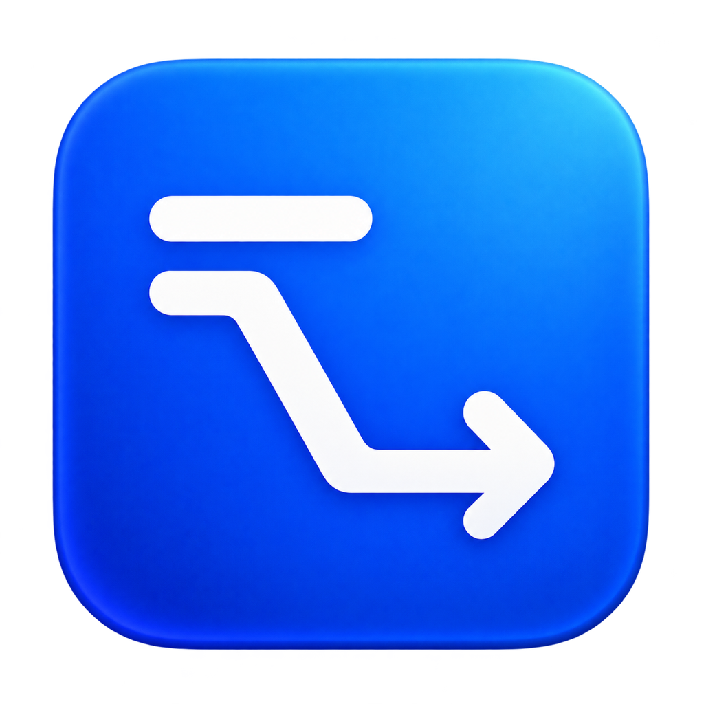
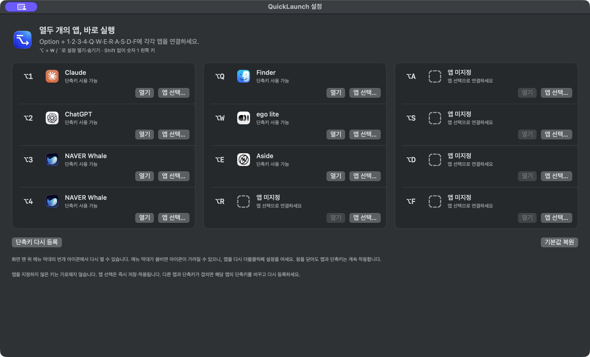

<p align="center">
  
</p>
<h1 align="center">QuickLaunch</h1>
<p align="center"><strong>자주 쓰는 앱 12개, Option 키로 바로.</strong><br>A tiny, native macOS app launcher. Twelve apps. One modifier.</p>
<p align="center">
  <a href="https://github.com/jaden2dev/QuickLaunch/releases/latest">다운로드</a> ·
  <a href="#사용법">사용법</a> ·
  <a href="#소스에서-빌드">빌드</a> ·
  <a href="LICENSE">MIT License</a>
</p>



QuickLaunch는 메뉴 막대에 머무르며, **Option + 1·2·3·4·Q·W·E·R·A·S·D·F**로 지정한 앱을 실행하거나 앞으로 가져옵니다. 각 단축키의 **앱 선택…** 버튼으로 원하는 앱만 연결하세요.

**Option + ₩ / `** 키로 설정 창을 열고 숨길 수 있어, 메뉴 아이콘이 MacBook 노치에 가려져도 바로 접근할 수 있습니다. 숫자 **1 왼쪽의 물결(~) 표시가 있는 키**를 사용하며 Shift는 누르지 않습니다.

## 다운로드

**[QuickLaunch 최신 버전 다운로드 →](https://github.com/jaden2dev/QuickLaunch/releases/latest)**

1. 위 페이지의 **Assets**에서 `QuickLaunch-v1.4.0-macos-arm64.zip`을 받습니다.
2. ZIP 파일을 더블클릭해 압축을 풉니다.
3. `QuickLaunch.app`을 **응용 프로그램(Applications)** 폴더로 옮기고 실행합니다.
4. 설정 창에서 각 키에 연결할 앱을 선택합니다.

**지원:** macOS 13 이상. 제공하는 실행 파일은 Apple Silicon(M1 이상)용입니다. Intel Mac은 아래 방법으로 소스에서 빌드할 수 있지만, Intel 실기기 검증은 하지 않았습니다.

현재 배포본은 로컬 임시 서명(ad-hoc)만 적용했고 Apple Developer ID 서명·공증은 받지 않았습니다. 다운로드한 앱은 macOS에서 실행이 차단될 수 있습니다. 이 경우 출처와 소스를 확인한 뒤 [Apple의 앱 열기 안내](https://support.apple.com/102445)를 참고하거나 소스에서 직접 빌드하세요.

업데이트할 때는 실행 중인 QuickLaunch를 종료하고 새 앱으로 교체하세요. 기존 앱 연결은 유지됩니다.

## 사용법

| 단축키 | 동작 / 최초 기본값 |
| --- | --- |
| **⌥ + ₩ / `** | QuickLaunch 창 열기·앞으로 가져오기 / 다시 누르면 숨기기 |
| ⌥1 | Visual Studio Code |
| ⌥2 | Google Chrome |
| ⌥3 | Terminal |
| ⌥4 | Slack |
| ⌥Q · ⌥W · ⌥E · ⌥R | 원하는 앱을 선택해 연결 |
| ⌥A · ⌥S · ⌥D · ⌥F | 원하는 앱을 선택해 연결 |

- **앱 선택…** → `.app` 선택 → 즉시 저장·적용됩니다.
- 이미 실행 중인 앱은 앞으로 가져오고, 닫힌 앱은 실행합니다.
- 앱을 지정하지 않은 Q/W/E/R/A/S/D/F 키는 가로채지 않습니다.
- 설정 창을 닫아도 단축키는 작동합니다. 종료는 메뉴 막대의 **QuickLaunch 종료**를 사용하세요.
- 설정 창이 다른 앱 뒤에 있으면 창 단축키로 앞으로 가져옵니다.
- 앱 선택 대화상자가 열린 동안에는 창 숨기기를 하지 않습니다.

### Finder도 연결할 수 있나요?

**앱 선택…**에서 **⌘⇧G**를 누르고 `/System/Library/CoreServices/`로 이동한 뒤 `Finder.app`을 선택하세요.

### 메뉴 아이콘이 안 보여요

노치 또는 메뉴 막대의 다른 아이콘 때문에 가려질 수 있습니다. **Option + ₩ / `**를 누르거나 `QuickLaunch.app`을 다시 더블클릭하면 설정 창이 열립니다. 아이콘이 보일 때 ⌘ 키를 누른 채 오른쪽으로 옮겨 둘 수도 있습니다.

### 단축키가 충돌해요

설정 화면에 등록 오류가 표시됩니다. 같은 키를 사용하는 다른 앱이나 시스템 설정을 변경한 뒤 **단축키 다시 등록**을 누르세요. 일부 키가 실패해도 나머지 키는 계속 작동합니다. 키는 문자 입력 결과가 아닌 ANSI 키보드의 물리적 위치를 기준으로 합니다.

## 소스에서 빌드

macOS 13 이상과 Swift 5.9 이상이 필요합니다. Xcode 또는 Command Line Tools를 설치하세요. 외부 패키지 의존성은 없습니다.

```bash
git clone https://github.com/jaden2dev/QuickLaunch.git
cd QuickLaunch
bash scripts/build-app.sh
open dist/QuickLaunch.app
```

```bash
swift test
```

`Package.swift`를 Xcode에서 열어 편집할 수도 있습니다. 앱 아이콘은 `assets/icon-1024.png`에서 생성됩니다. 빌드 결과는 `dist/QuickLaunch.app`이며 빌드한 Mac의 CPU 아키텍처를 따릅니다.

[자세한 빌드·문제 해결·수동 검증 가이드](docs/BUILDING.ko.md)

## 작동 방식과 개인정보

SwiftUI / AppKit으로 화면을 만들고 Carbon `RegisterEventHotKey`로 단축키를 등록합니다. `NSWorkspace`로 앱을 실행하며, 연결한 앱의 경로와 번들 ID는 이 Mac의 `UserDefaults`에 저장합니다.

계정, 서버, 분석 도구, 광고, 자동 업데이트는 없습니다. 키보드 전체를 감시하지 않으며 손쉬운 사용 권한이나 입력 모니터링 권한을 요구하지 않습니다. 설정 창을 여는 단축키도 QuickLaunch가 실행 중일 때 작동합니다.

## 기여와 라이선스

버그 제보와 개선 제안은 [Issues](https://github.com/jaden2dev/QuickLaunch/issues)로 보내 주세요. 개발 기여는 [CONTRIBUTING.md](CONTRIBUTING.md)를 참고하세요.

[MIT License](LICENSE) — Copyright © 2026 Jaden and QuickLaunch contributors.

QuickLaunch 아이콘은 이 프로젝트를 위해 AI로 생성했습니다. 스크린샷에 표시되는 다른 앱의 이름과 아이콘은 각 소유자의 자산이며 해당 앱과 제휴를 의미하지 않습니다.
